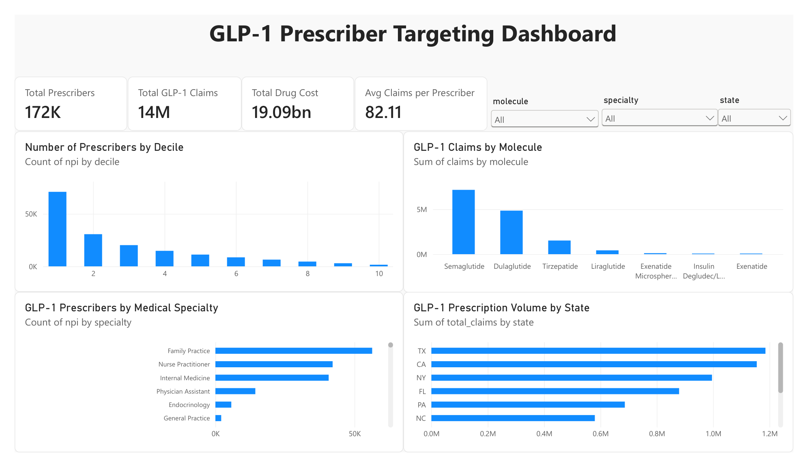

# GLP-1 Prescriber Targeting Dashboard (Medicare Part D)

Which prescribers should a GLP-1 diabetes brand's sales team visit first? This project ranks every Medicare Part D prescriber of GLP-1 drugs by prescription volume, tiers them into deciles the way pharma commercial teams do, and presents the result in an interactive Power BI dashboard.

**Tools:** SQL (DuckDB) · Python (pandas) · Power BI



## Key findings

- **Top prescribers:** The top five deciles (6–10) represent approximately 13.9% of prescribers but account for 50% of GLP-1 claims.
- **Specialty:** Family Practice has the highest total GLP-1 claim volume (4,064,455 claims), while Endocrinology has the highest average claims per prescriber (approximately 350).
- **Molecule:** Semaglutide leads in both Endocrinology (48.8% of claims) and Family Practice (50.6% of claims).

## Data

- [Medicare Part D Prescribers – by Provider and Drug](https://data.cms.gov/provider-summary-by-type-of-service/medicare-part-d-prescribers/medicare-part-d-prescribers-by-provider-and-drug), Centers for Medicare & Medicaid Services (CMS), [year] data
- [N]M rows (one per prescriber, drug and year), including [N]K prescribers of GLP-1 drugs: semaglutide, tirzepatide, dulaglutide, liraglutide and exenatide
- The raw file is several GB, so it isn't stored in this repo. Download it into `data/` to rerun the analysis.

## Approach

1. Loaded the full CSV into DuckDB and filtered the five GLP-1 molecules with SQL.
2. Aggregated to one row per prescriber: total claims, total drug cost and number of GLP-1 molecules used.
3. Built **volume-based deciles** with SQL window functions. Decile 10 is the small group of prescribers writing the first 10% of claims; decile 1 is the long tail writing the last 10%.
4. Compared specialties and states on total claims, claims per prescriber and number of top-decile prescribers, and calculated brand share within each specialty.
5. Exported the tables to a Power BI dashboard with KPI cards, decile, state, specialty and brand-share views, and slicers.

## Repository structure

```text
analysis.ipynb   the full analysis, SQL in DuckDB, step by step
sql/             the same SQL queries as separate files
powerbi/         DAX measures for the dashboard
data/            tables exported for Power BI (the raw CMS file is not included)
images/          dashboard screenshots
dashboard.pbix   the Power BI dashboard
```

## How to run

```bash
pip install -r requirements.txt
```

1. Download the CMS file and save it as `data/partd_prescriber_drug.csv`.
2. Run `analysis.ipynb`. It builds the tables and exports `data/glp1_prescribers.csv` and `data/glp1_prescriber_molecule.csv`.
3. Open `dashboard.pbix` in Power BI Desktop and click Refresh.

## Limitations

- Medicare Part D covers mostly people aged 65 and over, not commercial insurance.
- CMS removes rows with fewer than 11 claims to protect patient privacy.
- Claims count prescriptions, not patients.

## Next steps

- Add more years and track how prescribers move between deciles, to spot fast-growing prescribers early.
- Combine with Medicaid or commercial data for a fuller view of the market.

---

**Govind Bansal** · B.Pharm, BITS Pilani · [LinkedIn](https://www.linkedin.com/in/govind-bansal-42b95441b/) · [GitHub](https://github.com/govindbansal-pixel)
# glp1-prescriber-targeting
GLP-1 Prescriber Targeting using SQL, Python, DuckDB and Power BI
